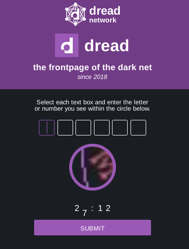
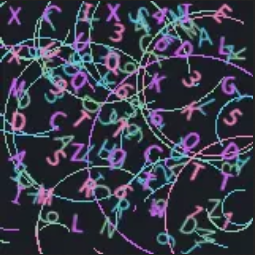
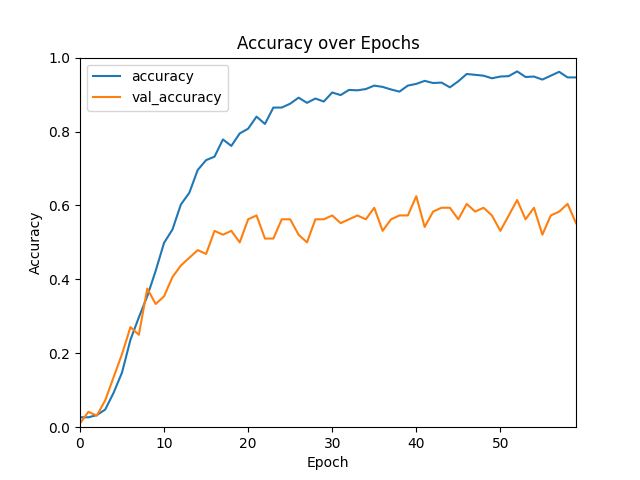

# Captcha Solving Darknet

## About this project

This project aims to creat a CAPTCHA solver for a platform on the darknet. For this purpose, a scraper for collecting
CAPTCHA samples is developed and used to generate an initial set of training data. A supporting tool will also be
developed for the subsequent labeling of the training data. Finally, an ML model for solving the corresponding CAPTCHA
is trained and evaluated on the basis of the labeled training data.

## Getting started

In order to achieve the wished functionalities there are two steps that have to be done. Namely, collecting samples and
creating a responsible ML model.

## Collecting Samples

The captcha wall of the given website consists of six fields with one char for each field which could a number or a letter.


<div align="center">

<p>The given website</p>
</div>

After clicking on each field a new part of the image will be displayed. Thus, only one image is being provided and after
clicking on field, the background image of the circle DIV will have the responsible letter (See picture below).

<div align="center">

<p>The provided background image for the six fields MDL1I6</p>
</div>


For that, it was necessary to enter a random value in each field, get the image DIV as png and save it locally. After
getting the six sub-images and manually entering the six guessed values the images will be saved in
[crawled_data](./crawled_data)
in a separate folder. This process was repeated until a decent amount of data was collected.

<div style="margin-right: 33%; margin-left: 33%">

<table>
  <tr>
    <td></td>
    <td></td>
    <td></td>
  </tr>
  <tr>
    <td></td>
    <td></td>
    <td></td>
  </tr>
 </table>
</div>


It's important to mention that the given samples aren't always different. During the collecting phase many duplications
of
the same six combinations were found. That's why the successfully crawled and labeled images where saved in a separate
folder to avoid repetition.
To prepare the data for training, every image was cropped to get the middle 121x121 pixels to avoid any extra parts and
then shrank into 32x32 pixels to minimize image size for better training performance. After that the images' shape was
changed from (32, 32, 4)
into (32, 32, 3) and then passed into the ML model. Since no chars/strings are allowed as label, the allowed chars were
encoded as the index of `allowed_chars = string.digits + string.ascii_uppercase`

## Model Architecture

The machine learning model created for this project is a Convolutional Neural Network (CNN), specifically designed for
image classification tasks.

### Layers

1. **Input Layer:**
    - Input Shape: 32x32 pixels (RGB)
    - Input Preprocessing: Images were cropped to 121x121 pixels to focus on the relevant regions and then resized to
      32x32 pixels.

2. **Convolutional Layers:**
    - Three convolutional layers with 3x3 kernels and ReLU activation.
    - MaxPooling layers after each convolutional layer.
3. **Dense Layers:**
    - Three fully connected dense layers with ReLU activation.

4. **Output Layer:**
    - Output Nodes: 36 (corresponding to digits 0-9 and uppercase letters A-Z)
    - Activation Function: Softmax for multi-class classification.

### Activation Functions

- ReLU (Rectified Linear Unit) activation is applied in the convolutional and dense layers.

### Training Process

- Loss Function: Categorical Crossentropy
- Optimization: Adam optimizer
- Number of Epochs: 60
- Batch Size: 32

## Results

During training, the model achieved an accuracy of approximately 50-60%. Further experiments revealed that the optimal
number of epochs for this specific task is 60.


<div align="center">

<p>Model Accuracy over Epochs</p>
</div>

It's worth mention that the number of available images is pretty small, approx. 1000 pictures. Despite that the captcha
generator should be randomized, it turned out the many pictures/char combinations are repeated. Thus, it wasn't possible to crawl more
images because of the high number of repetition. On the other hand the model has more than ca. 50% of successful logins thanks to the repetition.

## Installation

To use this project locally you firstly need to install
[TOR](https://www.torproject.org/download/tor/) and [geckodriver](https://github.com/mozilla/geckodriver/releases) for
Selenium webdriver

After that you can clone the project, change `tor_path` in [consts.py](./consts.py) to match its path on your PC, create
a venv and install the needed dependencies:

```
git clone origin https://git.rwth-aachen.de/captcha-solving-darknet/captch-solving-darknet.git
cd captacha-solving-darknet
virtualenv venv 
source venv/bin/activate
pip install -r requirements.txt
```

## How to use?
Execute the following files to test the program:

[Crawl images locally](./dread_crawl_images_manually.py)

[Test the CNN model](./dread_test_model.py)

[Train a new model](./neural_network/train_network.py)

## Author

Mazen Alkatlabee


